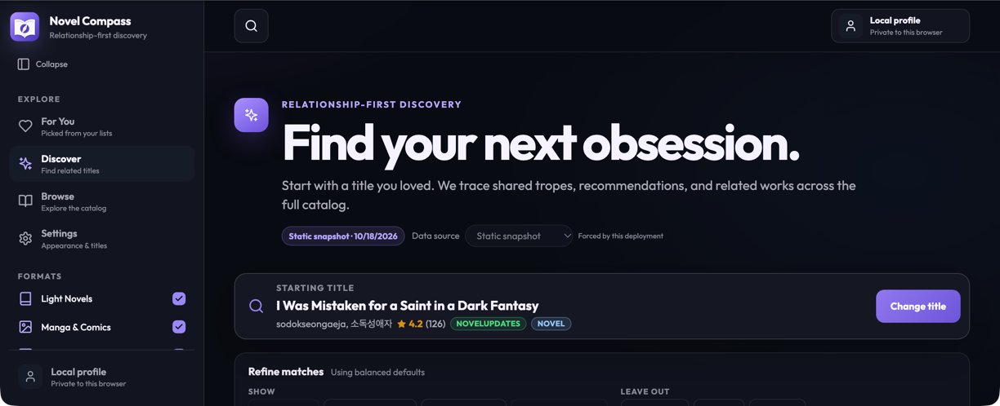
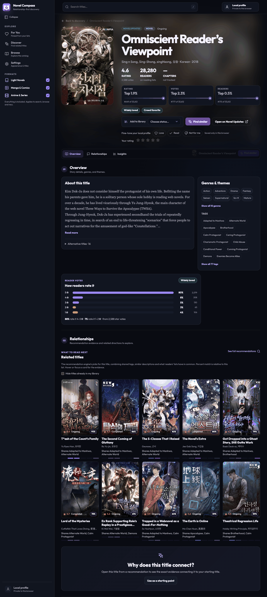
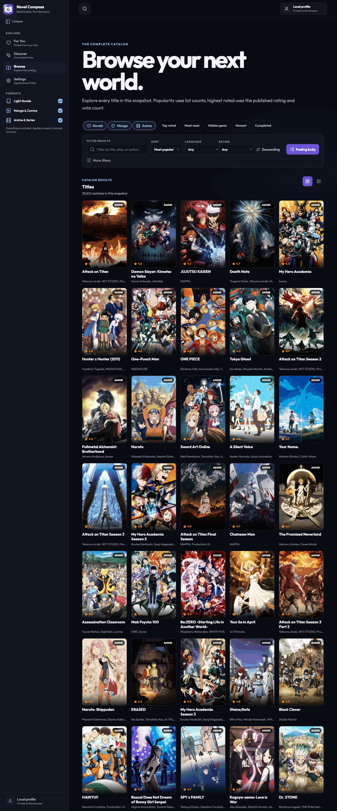

# Novel Compass Chrome Extension

Restyles Novel Updates with Novel Compass navigation while preserving the
site's live links, releases, reviews, rankings, lists, and account actions.

## Screenshots

Screenshots of the [Novel Compass web app](https://cbangera2.github.io/NovelCompass/).

### Discover

Relationship-first discovery: pick a starting title you loved and the
recommendation engine traces shared tropes, related works, and community recs
across the full catalog. Shown with refine filters and the first rows of
evidence-backed matches for a seed title.



### Series detail

The cover, essential metadata, and percentile stats fit in the first viewport;
the overview, reader vote breakdown, and related titles continue down the page
(insights follow below the captured area).



### Browse the catalog

Every title in the snapshot, with quick format and ranking chips plus sort,
language, and rating filters. Shown with the Anime format selected, sorted by
most popular.



Screenshots contain page content only. Personal account details are excluded.

## Build the lightweight extension

The default build is the Chrome Web Store candidate. It includes all Novel
Updates route restyling, but no recommendation/search snapshot:

```bash
pnpm --dir web run package:extension
```

Then open `chrome://extensions`, enable **Developer mode**, choose
**Load unpacked**, and select:

```text
extension/dist
```

The validated ZIP is written to:

```text
extension/dist/novel-compass-extension.zip
```

The validator enforces the core bundle budgets and rejects `.git`, `.DS_Store`,
source maps, and other packaging debris.

## Deterministic fixture build

Use the three-title dataset for deterministic enhanced-feature tests:

```bash
pnpm --dir web run test:extension
pnpm --dir web run package:extension:fixture
```

## Full offline developer build

The large local snapshot is an explicit developer artifact and is not suitable
for the Chrome Web Store:

```bash
pnpm --dir web run package:extension:offline-full
```

Every build replaces `extension/dist`. The offline copy step excludes nested
Git metadata and packaging debris.

## Local fixture server

For parser and fallback fixture pages:

```bash
pnpm --dir web run fixtures:extension
```

Live Novel Updates testing remains necessary for authenticated chapter,
reading-list, rating, and review behavior. Never save cookies or active session
tokens into repository fixtures.
